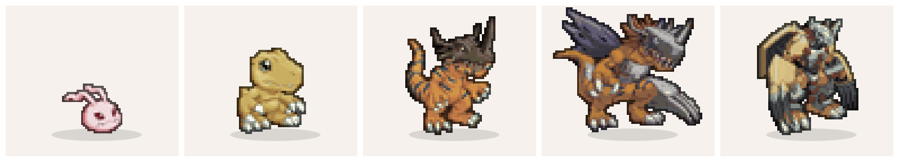
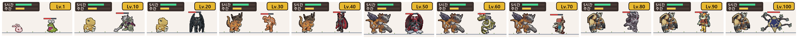
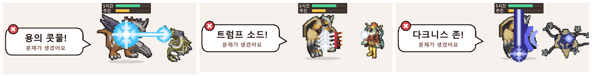

# Digimon_mod — Claude Code 입력창 위의 디지몬 어드벤처

Claude Code가 일하는 동안 입력창 위에서 내 파트너 디지몬이 디지몬 어드벤처의 빌런과 싸우는 모드입니다.
작업 상태(일하는 중·끝남·기다림·오류)와 사용 한도를 디지몬의 전투와 HP로 보여 주고, 많이 쓸수록 레벨이 올라 유년기에서 궁극체까지 진화합니다.



## 주요 기능

- **상태 알림 띠**: 입력창 바로 위에 지금 상태를 그림으로 보여 줍니다.
  - 일하는 중: 내 디지몬이 레벨에 맞는 상대에게 고유 기술을 쏘고, 데미지 숫자가 뜹니다. 데미지는 이번 응답에서 쓴 점수입니다(아래 [HP 점수](#hp-점수)).
  - 일이 끝나면: 디지몬이 확 커지며 "다 했어요! 결과 확인해 주세요" 말풍선이 뜨고, 이번 응답에서 쓴 양(`이번 응답 12점 · 주간 0.1% · 5시간 0.4%`)을 알려 줍니다.
  - 사람을 기다릴 때: 권한 요청(1.5초 넘게), 질문, 계획 승인을 "잠깐만요!"로 알립니다.
  - 오류로 멈추면: 상대가 자기 기술로 내 디지몬을 치고 "○○의 △△! 문제가 생겼어요"라고 알립니다.
  - 쉬는 동안: 지금 모습의 디지몬과 HP 막대 두 줄(5시간·주간 한도, 남은 점수 / 풀피, 회복 시각), 레벨·경험치 줄을 보여 줍니다.
- **사용량 = 경험치**: 주간 한도 사용률(%)이 경험치입니다. 레벨 10마다 상대를 쓰러뜨리고 진화하거나 기술을 얻습니다.
- **매달 바뀌는 문장**: 선택받은 아이들의 문장 8개 가운데 하나가 매달 뽑히고, 그 파트너 디지몬으로 한 달을 싸웁니다.
- **디지바이스 임시 진화**: 일을 잘 마칠 때 1% 확률로 디지바이스를 찾아 그달 동안 한 단계 위 모습으로 싸웁니다.
- **히든 진화 오메가몬**: 용기·우정 시즌에서 각각 궁극체에 닿으면, 그 뒤로는 어느 시즌이든 Lv.100에 오메가몬이 됩니다.
- **한국판 더빙 이름**: 디지몬과 기술 이름은 한국판 더빙 명칭(파피몬, 쉬라몬, 꼬마 불꽃, 썰렁포 등)을 씁니다.





## 필요한 것

| 항목 | 내용 |
| --- | --- |
| Claude Code | 데스크톱 앱 (2.1.295에서 확인) |
| 계정 | 사용 한도(5시간·주간)가 표시되는 구독 계정 |
| 환경 변수 | `CLAUDE_CODE_PLUGIN_DIRS`, `CLAUDE_CODE_ENABLE_FUNCTION_HOOKS=1` (설치 2단계) |
| Node.js | 선택. 설치 전 사용량을 불러올 때만 (`scripts/seed.mjs`) |

- 그림은 데스크톱 앱에서만 나옵니다. 터미널(CLI)에서는 그림 없이 글자 줄(상태·HP·레벨)만 나옵니다.
- 한도 정보가 없는 계정에서는 HP와 레벨을 표시하지 않습니다.

## 설치

1. 저장소를 받습니다.

   ```bash
   git clone https://github.com/momozzing/Digimon_mod.git ~/.claude/mods/Digimon_mod
   ```

2. `~/.claude/settings.json`의 `"env"`에 두 줄을 넣습니다. 다른 내용은 그대로 둡니다.

   ```json
   "env": {
     "CLAUDE_CODE_PLUGIN_DIRS": "/home/<사용자이름>/.claude/mods/Digimon_mod",
     "CLAUDE_CODE_ENABLE_FUNCTION_HOOKS": "1"
   }
   ```

   - 윈도우: `"C:\\Users\\<사용자이름>\\.claude\\mods\\Digimon_mod"`
   - macOS: `"/Users/<사용자이름>/.claude/mods/Digimon_mod"`

3. (선택) 달 중간에 설치했다면 이번 달 1일부터 쓴 양을 불러옵니다. 24시간 안에 앱을 다시 시작해야 반영됩니다.

   ```bash
   node ~/.claude/mods/Digimon_mod/scripts/seed.mjs
   ```

4. Claude 데스크톱 앱을 완전히 껐다 켭니다.

정상이면 입력창 위에 디지몬 한 마리와 HP 막대 두 줄, `Lv.○ ○○몬 ⚔ ○○몬` 줄이 보이고, 이달의 문장을 알리는 알림이 한 번 뜹니다.

### 업데이트와 끄기

- 업데이트: 모드 폴더에서 `git pull` 후 입력창에 `/reload-plugins`. 3단계에서 `seed.mjs`를 돌렸다면 `hooks/seed.ts`가 바뀌어 있으니 먼저 `git checkout hooks/seed.ts`로 되돌립니다.
- 끄기: `settings.json`의 `CLAUDE_CODE_PLUGIN_DIRS`에서 모드 경로를 지우고 앱을 다시 시작

## 레벨과 상대

- 경험치는 주간 한도 사용률(%)입니다. 2 XP마다 1레벨이라, 2주 동안 매주 한도를 다 쓰면 200 XP로 Lv.100입니다.
- 한 시즌은 한 달(한국 시간 1일 0시부터)이고, 달이 바뀌면 Lv.1부터 다시 시작합니다.
- 여러 창(세션)을 열어도 기록 하나를 같이 써서 같은 사용량을 두 번 세지 않습니다. 쉬는 창은 1분마다 레벨과 HP를 맞춥니다.
- 상대의 체력 막대는 다음 진화·기술까지 남은 경험치입니다. Lv.100의 최종 보스는 체력이 줄지 않고 시즌 끝까지 싸웁니다.

| 레벨 | 상대 (단계) | 내 디지몬 (단계) |
| --- | --- | --- |
| 1~9 | 워매몬 (성숙기) | 유년기 |
| 10~19 | 우가몬 (성숙기) | 성장기 (Lv.10 진화) |
| 20~29 | 데블몬 (성숙기) | 성장기 (Lv.20 기술) |
| 30~39 | 에테몬 (완전체) | 성숙기 (Lv.30 진화) |
| 40~49 | 묘티스몬 (완전체) | 성숙기 (Lv.40 기술) |
| 50~59 | 베놈묘티스몬 (궁극체) | 완전체 (Lv.50 초진화) |
| 60~69 | 메탈시드라몬 (궁극체) | 완전체 (Lv.60 기술) |
| 70~79 | 피노키몬 (궁극체) | 완전체 (Lv.70 기술) |
| 80~89 | 파워드라몬 (궁극체) | 궁극체 (Lv.80 궁극진화) |
| 90~99 | 피에몬 (궁극체) | 궁극체 (Lv.90 기술 강화: 1.3배) |
| 100 | 아포카리몬 (궁극체, 최종 보스) | 궁극체 (Lv.100 기술 극대화: 1.6배) |

상대의 기술(오류 알림에서 씀): 워매몬 똥 던지기 · 우가몬 몽둥이 찍기 · 데블몬 데스 클로 · 에테몬 러브 세레나데 · 묘티스몬 크림슨 라이트닝 · 베놈묘티스몬 베놈 인퓨즈 ·
메탈시드라몬 용의 콧물 · 피노키몬 불릿 해머 · 파워드라몬 무한 캐논 · 피에몬 트럼프 소드 · 아포카리몬 다크니스 존. `hooks/monsters.ts`의 `FOES` 표에서 바꿉니다.

## HP 점수

앱은 한도의 크기(토큰 몇 개인지)를 알려 주지 않고, 사용률도 0.1% 단위라 응답 하나로는 거의 움직이지 않습니다.
그래서 HP와 데미지를 점수로 보여 줍니다.

- **점수**: 응답마다 앱이 알려 주는 토큰 수에 공개 가격의 비율로 무게를 준 값입니다. **가중 토큰 1,000개 = 1점**이고, 구독 요금과는 관계없습니다.
  무게는 입력 1, 출력 5, 캐시 읽기 0.05, 캐시 쓰기 1.25입니다(`scripts/seed.mjs`와 같은 비율).
- **데미지**: 이번 응답에서 늘어난 점수입니다(예: `-12`). 화면은 8초에 한 번까지 고치고, 응답이 끝나면 최종값으로 맞춥니다.
  메인 대화의 응답만 셉니다. 서브에이전트가 쓴 토큰은 점수에 안 들어갑니다.
- **풀피**: `남은 점수 / 풀피`의 풀피는 **어림값**입니다. 사용률은 1% 단위로 오르므로, 한 칸 오른 순간부터 다음 칸 오른 순간까지
  모든 창이 쓴 점수를 1%로 봅니다. 모드를 켠 뒤 사용률이 처음 오른 순간부터 세기 시작해서, 주간은 1칸·5시간은 2칸 더 오르면 숫자가 나옵니다.
  그 전에는 %만 보여 줍니다. 풀피는 사용률이 오를 때만 바뀌고, 응답하는 동안에는 바뀌지 않습니다.
- 막대 길이와 %는 앱이 주는 실제 사용률 그대로입니다.

어림이 틀어질 수 있는 경우:

- claude.ai 채팅·모바일처럼 이 모드가 없는 곳에서 쓴 양과 서브에이전트가 쓴 양은 사용률에는 잡히고 점수에는 안 잡힙니다. 그러면 풀피가 실제보다 작게 어림됩니다.
- 구독 한도가 토큰 종류·모델별로 API 정가와 같은 비율로 깎이는지는 공개되지 않았습니다. 응답 내용에 따라 같은 점수라도 사용률이 다르게 오를 수 있습니다.

## 문장과 진화 계열

매달 1일에 이달의 문장이 하나 뽑힙니다. 8개가 겹치지 않게 돌고, 지난달 문장은 다음 달에 나오지 않습니다.
진화 구간은 성장기 Lv.10, 성숙기 Lv.30, 완전체 Lv.50, 궁극체 Lv.80이고, Lv.90에는 기술이 1.3배, Lv.100에는 1.6배로 커집니다.

| 문장 | 유년기 → 성장기 → 성숙기 → 완전체 → 궁극체 | 기술 (한국판 더빙명, 연출) |
| --- | --- | --- |
| 용기 | 코로몬 → 아구몬 → 그레이몬 → 메탈그레이몬 → 워그레이몬 | 거품 → 꼬마 불꽃(불덩이) → 메가 파이어(큰 불덩이) → 인공지능 미사일(가슴 미사일 2)·왕발톱 → 테라 광선(머리 위 큰 에너지구) |
| 우정 | 뿔몬 → 파피몬 → 가루몬 → 워가루몬 → 메탈가루몬 | 거품 → 파란 불꽃 → 푸른 화염포(큰 파란 불꽃) → 초강력 손톱(발톱, 근접) → 썰렁포(얼음 빔) |
| 사랑 | 어니몬 → 피요몬 → 버드라몬 → 가루다몬 → 페닉스몬 | 거품 → 빙빙 회오리(초록 불꽃) → 메테오 윙(떨어지는 불덩이) → 불새 출격(큰 불덩이)·이글 클로 → 스타라이트 익스플로전(별 비) |
| 순수 | 시드몬 → 팔몬 → 니드몬 → 릴리몬 → 로제몬 | 거품 → 독줄기 공격(덩굴) → 바늘뿜기(바늘) → 플라워 캐논(꽃 포탄) → 릴리몬의 유혹(가시 채찍) |
| 지식 | 모티몬 → 텐타몬 → 캅테리몬 → 아트라캅테리몬 → 헤라클레스캅테리몬 | 거품 → 꼬마 번개(전기 불꽃) → 일렉트로 쇼커(전기구) → 혼 버스터(뿔 전기 빔) → 메가 블래스터·울트라 썬더(번개) |
| 성실 | 둥실몬 → 쉬라몬 → 원뿔몬 → 쥬드몬 → 바이킹몬 | 거품 → 물고기 행진(색색의 물고기 떼) → 뿔 날리기(뿔 작살) → 해머 스파크(망치, 근접+번개) → 아크틱 블리자드(철퇴, 근접) |
| 희망 | 토코몬 → 파닥몬 → 엔젤몬 → 홀리엔젤몬 → 세라피몬 | 거품 → 공기팡(바람 고리) → 천사의 손(주먹에서 금빛 빔) → 천국의 문(빛기둥)·엑스칼리버 → 세븐 헤븐즈(빛구 7개) |
| 빛 | 야옹몬 → 플롯몬 → 가트몬 → 엔젤우몬 → 오파니몬 | 거품 → 퍼피 하울링(음파) → 냥냥펀치(발톱, 근접) → 천국의 화살(분홍 화살)·천국의 미소 → 낙원의 창(창 던지기+빛기둥) |
| 조그레스 | 오메가몬 (히든) | 가루루 캐논(얼음 빔)·그레이 소드(베기) |

한국판 더빙명은 나무위키·위키백과에서 확인한 것(꼬마 불꽃, 메가 파이어, 인공지능 미사일, 왕발톱, 테라 광선, 파란 불꽃, 푸른 화염포, 썰렁포, 빙빙 회오리, 불새 출격, 독줄기 공격, 릴리몬의 유혹, 혼 버스터, 물고기 행진, 뿔 날리기, 바늘뿜기·꼬마 번개(사용자 확인), 천사의 손, 천국의 문, 천국의 화살, 천국의 미소, 낙원의 창)을 쓰고,
한국판에 나오지 않았거나 확인하지 못한 기술(메테오 윙, 플라워 캐논, 일렉트로 쇼커, 해머 스파크, 공기팡, 냥냥펀치, 궁극체 기술)은 원어 또는 통용 이름입니다.
진화 계열과 이름은 나무위키 디지몬 어드벤처 진화 트리(한국판)를 따릅니다. 궁극체는 극장판·설정 기준(페닉스몬·로제몬·바이킹몬·세라피몬·오파니몬)입니다.

### 디지바이스

- 일을 잘 마칠 때마다(오류·Esc 제외) 1% 확률로 끝 알림에 디지바이스가 나옵니다. 한 달에 한 번, 아직 궁극체가 아닐 때만 나옵니다.
- **확인**을 누르면 한 진화 단계 위 모습이 되어 그달 남은 기간 동안 그 모습과 기술로 싸웁니다(예: Lv.15 아구몬 → 그레이몬).
- 레벨·상대·경험치는 그대로이고, 새 달이 되면 효과가 끝납니다. 다른 창에서 찾은 디지바이스는 쉬는 띠의 **진화** 버튼으로 씁니다.

### 히든 진화 오메가몬

용기 시즌에서 워그레이몬(Lv.80), 우정 시즌에서 메탈가루몬(Lv.80)에 각각 한 번이라도 닿으면(다른 달이어도 됨) 알림이 뜹니다.
그 뒤로는 어느 시즌이든 Lv.100에 오메가몬으로 조그레스 진화해 아포카리몬과 싸웁니다(가루루 캐논·그레이 소드).

## 알아 둘 점

- 데스크톱 앱은 화면을 나눴을 때 입력창 위 띠를 **맨 왼쪽 칸**에만 그립니다. 다른 칸에서 일한 경험치와 HP는 1분 안에 왼쪽 칸에 반영됩니다.
- 끝·오류 알림은 다음 지시를 보내거나 **확인**을 누르면 사라집니다. Esc로 직접 멈춘 턴은 알리지 않습니다.
- 자동 모드에서 분류기가 정하는 권한 확인은 알리지 않습니다.

## 직접 고치기

### 파일 구성

| 경로 | 내용 |
| --- | --- |
| `hooks/register.tsx` | 모드 본체: 상태, 경험치·시즌, 띠와 알림 그리기, 히든 진화 조건, 디지바이스 |
| `hooks/sprites.ts` · `hooks/pixel.ts` | 띠·알림의 화면 틀(HP 이름표, 말풍선, HP·경험치 막대)과 공용 색·칸 그리기 |
| `hooks/digi.ts` | 디지몬 계열 공통: 도트 스프라이트 놓기, 진화 단계, 움직임, 기술 강화, 발사 위치 |
| `hooks/fx.ts` | 기술 효과: 벡터 원화(`ARTS`)와 날아가기·충격·빔 같은 움직임 |
| `hooks/monsters.ts` | 상대 11종의 이름·키·방향·기술, 체력 막대, 오류 알림의 공격 장면 |
| `hooks/atk.ts` | 공격 주기 상수 |
| `hooks/jobs/*.ts` | 계열 8개 (자동 생성, 손으로 고치지 말 것) |
| `hooks/img/*.ts` | 도트 그림을 색마다 path 하나인 벡터로 심은 모듈 (자동 생성, `omega.ts`는 공용 오메가몬) |
| `art/` | 도트로 바꾸기 전 원본 일러스트와 출처(`art/SOURCES.md`) |
| `sprites/` | 도트로 바꾼 PNG (디지몬·상대·기술 효과) |
| `preview/` | 그림 만들기·미리보기 도구 |

### 그림과 기술 바꾸기

1. **디지몬·상대 그림**: `art/<묶음>/<키>.png`를 바꾼 뒤 `python3 preview/pixelate-all.py` → 화면 크기에 맞춰 1칸당 4점·32색 도트로 바꿔 `sprites/`에 씁니다.
   이어서 `python3 preview/embed.py <묶음>`으로 `hooks/img/<묶음>.ts`에 심습니다. 점 하나하나를 사각형(path)으로 바꿔 심습니다.
   데스크톱 앱은 Svg 안의 `<image>`(base64 PNG)를 그리지 않으므로 그림을 PNG로 심으면 안 됩니다.
2. **진화 단계·키·방향·발사 위치·기술·근접 여부**: `preview/gen-lines.py`의 표(`LINES`, `FX`, `MELEE`, `OMEGA`)를 고치고 실행하면 `hooks/jobs/*.ts`가 다시 만들어집니다.
   `python3 preview/mouths.py preview/out/mouths.png`로 발사 위치를 그림 위에 점으로 찍어 확인할 수 있습니다.
3. **기술 효과 그림**: `hooks/fx.ts`의 `ARTS`를 고치고 `./preview/build-fx.sh` → 1칸당 4점 도트 PNG로 구워 `sprites/fx/`와 `hooks/img/fx.ts`에 넣습니다.
4. **미리보기**: `./preview/render-all.sh`(쉬는 모습·전투)와 `./preview/attack-sheet.sh`(공격 순간)가 `preview/out/`에 PNG를 만듭니다.
   node 22, cairosvg, Pillow가 필요합니다. 정지 화면이라 돌진·채찍처럼 움직이는 효과는 실제 앱에서만 보입니다.

- 그림은 SVG 안에 벡터(색마다 path 하나)로 들어갑니다. 그림 한 장(SVG)은 앱 한도 131,072자 안이어야 하고, 지금 가장 큰 것은 약 67,000자입니다.
- 모드 이름(`plugin.json`의 `name`)은 `digimon-buddy`입니다. 시즌 기록이 이 이름 아래에 저장되므로, 바꾸면 레벨·경험치가 처음부터 다시 시작될 수 있습니다.
- 모드 테스트: `claude plugin test <모드 폴더>`

## 라이선스

코드는 [MIT](LICENSE)입니다. 디지몬 캐릭터·이름·그림(`art/`, `sprites/`, `hooks/img/`, `docs/`)은 반다이남코·도에이 애니메이션의 저작물로 MIT 대상이 아니며,
비상업 팬 용도로만 넣어 두었습니다. 이 프로젝트는 반다이남코·도에이 애니메이션과 관계가 없습니다.
그림 원본은 [위키몬](https://wikimon.net)의 디지몬 서바이브·뉴 센추리 일러스트이고, 출처는 `art/SOURCES.md`에 있습니다.
