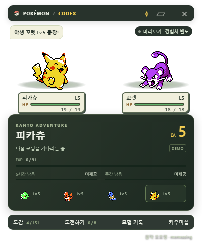
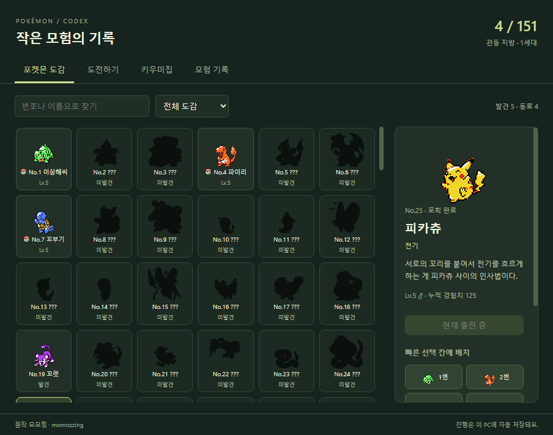

# AI Agent 포켓몬 키우기

코딩하는 동안 포켓몬을 만나고, 잡고, 키우는 작은 Windows 데스크톱 게임입니다. 작업에 집중한 뒤 도감과 모험 기록에서 동료들의 모험을 돌아볼 수 있습니다.

**원작 모모찡 · momozzing** — [Digimon_mod](https://github.com/momozzing/Digimon_mod)에서 출발한 비영리 팬 프로젝트입니다. 원작의 MIT 라이선스와 표기를 유지하며, Bakzzi가 추가·수정한 코드도 [MIT 라이선스](LICENSE)로 공개합니다.

**[Windows 실행 파일 받기 · 최신 릴리스](https://github.com/Bakzzi/Pokemon_codex/releases/latest)**

Android용 **포켓몬 작은 모험**은 [mobile 브랜치 안내](mobile/README.md)를 참고하세요. 폰을 잠그면 모험하고, 잠금 중 걸음 수로 한 번 더 모험하는 별도 앱입니다.

릴리스의 portable ZIP을 받아 압축을 풀고 **PokemonCodex.exe**를 실행하세요. 폴더 안의 파일을 함께 유지하면 됩니다. 포터블 실행에는 Node.js가 필요 없습니다. GitHub의 Source code ZIP은 실행 파일 배포본과 다릅니다.

  
  

## 사용하기

- Codex 또는 Claude Code에서 작업하면 위젯이 로컬 작업 상태와 사용량을 읽어 모험을 진행합니다. API 키나 hooks를 따로 설정하지 않습니다. 일반 Claude 채팅의 사용량을 연동하는 기능은 아닙니다.
- 읽을 수 있는 작업 기록에 따라 상단에 **CODEX**, **CLAUDE**, **CODEX + CLAUDE**를 표시합니다. 아직 기록이 없으면 **AI AGENT**로 표시합니다.
- Claude Code는 `~/.claude/projects` 또는 `CLAUDE_CONFIG_DIR/projects`의 기록을 읽습니다. 과거 사용량은 경험치로 소급하지 않으며, 새 작업의 실제 출력 토큰만 반영합니다. 기록에 없는 남은 사용 한도는 **미제공**으로 표시합니다. 둘 다 연동되면 한도에는 Codex 출처를 표시합니다.
- 상단이나 배틀 배경을 드래그해 이동합니다. ⌖는 항상 위에, ▱는 작게 보기, −는 트레이로 숨기기, ×는 종료입니다.
- 작게 보기에서는 남은 사용 한도를 확인할 수 있습니다. 기록에서 한도를 제공하지 않으면 미제공으로 표시합니다.
- **도감**에서 도감과 동료를 확인하고, 최대 여섯 개의 선택 칸에 배치합니다. 빈칸을 모두 채울 필요는 없습니다.
- **타운맵**, **가방**, **모험 기록**에서 진행 중인 모험과 보유 물품, 지난 결과를 확인합니다.
- **타운맵**에는 **지도·배지함**이 있습니다. 목적지를 누르면 도로마다 야생 포켓몬과 10~20번 무작위로 만난 뒤 다음 구간으로 자동 이동합니다. 마을에서도 인접한 도로의 포켓몬을 만나며, 체육관의 관장·라인업·도전 버튼을 지도 옆에서 바로 확인합니다. 체육관과 이야기 속 도전은 직접 시작합니다. 새로운 소식은 `!`로 표시되며, 길이 막혀 있어도 현재 구간의 자동 모험은 계속됩니다. 배틀 중 이동 예약은 종료 후 실행하고, 지나온 모험과 나눈 이야기는 **모험 기록**에서 다시 볼 수 있습니다.
- 배틀과 교체는 자동으로 진행됩니다. 진행 중에 요청한 행동은 화면에 표시되는 대기 조건을 충족하면 실행하며, 예약 목록에서 취소할 수 있습니다.
- 전투 판정은 파이어레드·리프그린의 3세대 규칙과 ‘교체’ 방식을 기준으로 합니다. 기절 후 강제 교체와 상대 기절 후 무료 교체는 다음 턴의 공격 기회를 소모하지 않습니다.
- 트레이너 대사는 위젯에서 직접 눌러 넘깁니다. 대화가 기다릴 때는 도감의 **대화 보기**로 위젯을 다시 열 수 있습니다. **연동 설정**의 **완전 초기화**는 별도 확인 후 게임 진행을 지우며 연동·위젯 설정은 유지합니다.
- 새로운 만남과 진행 요소는 모험 속에서 직접 발견해 보세요. 선택에 따른 중요한 변경 사항은 실행 전에 게임 화면에서 안내합니다.

PC와 Android는 공통 게임 규칙과 스토리·도전 화면을 함께 사용합니다. PC는 에이전트 작업량, Android는 잠금 시간과 걸음 수로 모험을 진행하며 화면 배치는 각 기기에 맞춥니다.

## 다른 PC에서 코딩할 때

**연동 설정** 탭 또는 트레이의 **AI Agent 연동 설정**에서 원격 PC를 추가하세요. 원격 PC의 Codex와 Claude Code 기록을 자동으로 구분합니다. SSH 호스트 주소·계정·포트를 입력하고 비밀번호 또는 개인키로 로그인합니다. 이 PC의 기본 SSH 접속 기록(`~/.ssh/known_hosts` 등)에 저장된 서버 키와 일치하면 자동으로 확인합니다. 기록이 없는 서버는 화면의 **서버 확인 방법**에 따라 서버 식별 번호를 비교한 뒤 등록하세요. 사용자별 연결 대상은 이 PC에서 직접 등록하며 기본으로 등록된 서버는 없습니다.

기존 SSH 접속 기록은 읽기만 하며 수정하지 않습니다. 호스트 이름·포트·해시 처리된 호스트 기록을 구분하며, 기존 기록과 서버 키가 다르거나 사용 중지된 키이면 자동 연결하지 않습니다. 사용자 지정 SSH 기록 경로나 인증서 기반 서버 확인은 현재 자동으로 가져오지 않습니다.

원격 PC에는 SSH 접속 환경과 Node.js 18 이상이 필요합니다. `node`가 SSH 환경의 실행 경로에 없다면 **원격 실행 환경**에서 Node.js 실행 파일의 전체 경로를 입력하세요. 원격 위젯 설치나 별도 포트 개방 없이 수집기를 메모리에서 실행합니다. 점프 호스트·다단계 인증은 현재 지원하지 않습니다.

작업 상태와 숫자 사용량·한도만 암호화된 SSH 연결로 받아 로컬 모험에 반영합니다. 처음 연결하기 전 기록은 경험치로 소급하지 않으며, 연결이 복구되면 이미 확인한 세션의 사용량 증가분만 한 번 반영합니다. 같은 세션 기록이 로컬·원격에 함께 있어도 중복 집계하지 않습니다. 원격 로그가 삭제되거나 관측 범위를 벗어나면 그 사이 사용량은 복구하지 못할 수 있습니다.

로그인 정보는 기본적으로 저장하지 않습니다. **이 PC에 로그인 정보 암호화 저장**을 선택한 경우에만 Windows 보호 기능으로 암호화하여 `%APPDATA%\PokemonCodexBuddy\remote-secrets.json`에 저장합니다. 연결 설정과 서버 지문은 같은 폴더의 `remote-connections.json`에 보관합니다. 개인키 원본은 선택한 위치에 그대로 두며 복사하거나 Git에 추가하지 않습니다.

## 저장과 월간 시즌

진행과 창 설정은 **%APPDATA%\PokemonCodexBuddy\progress.json**에 저장합니다. 진행 파일과 백업은 배포 폴더와 별개이므로 삭제하지 마세요.

**v0.3.65부터 Windows 배포본은 자동 업데이트가 기본으로 켜져 있습니다.** 실행 후와 약 6시간마다 이 저장소의 정식 GitHub 릴리스를 확인합니다. 내려받은 파일을 검증하고, 열린 관리 창을 닫고 현재 연출이 끝나면 진행을 저장한 뒤 재시작합니다. 기존 v0.3.64 이하 사용자는 처음 한 번 최신 ZIP으로 교체해야 합니다. 소스로 실행하는 개발 환경에는 자동 적용하지 않습니다.

트레이 메뉴에서 **업데이트 확인**과 **자동 업데이트** 설정을 사용할 수 있습니다. 인터넷 연결이나 다운로드가 실패해도 모험은 계속됩니다. 배포 파일을 직접 수정했거나 새 파일과 사용자 파일이 충돌하면 자동 적용을 보류합니다. 새 버전 실행에 실패하면 이전 파일의 복구를 시도하며, 복구 파일과 준비 중인 파일은 실행 폴더의 `.pokemon-updates`에 보관합니다. 정상 적용 후에는 직전 버전의 복구 파일을 남기고 검증된 오래된 업데이트 파일을 정리합니다. 저장·연결 설정과 그 백업은 이 정리 대상이 아닙니다.

**한국시간 매월 1일 00:00에 새 시즌이 시작됩니다.** 진행 중인 배틀과 결과 연출이 끝난 뒤 적용하며, 꺼 둔 경우 다음 실행 때 적용합니다. 보유 개체와 레벨, 뱃지, 모험 진행, 물품 등 시즌 기록은 새로 시작하고, **누적 도감 기록과 도감 경험치 부스터, 에이전트 읽기 기준과 창 설정은 유지**합니다. 초기화 직전 진행 파일은 자동으로 백업합니다.

손상된 저장은 사본을 보존한 뒤 실행을 중단합니다. 새 버전의 저장을 이전 버전으로 열지 마세요. 복구가 필요하면 위젯을 종료하고 해당 버전의 백업을 사용하세요.

## 에이전트 연동과 개인정보

- 로컬 Codex·Claude Code 기록을 읽기 전용으로 관측합니다. 작업 상태와 숫자 토큰·한도 필드만 사용합니다. 대화·도구 실행 내용은 보관하거나 전송하지 않습니다.
- 대화 본문, 도구 인자, 인증정보와 계정 잔액은 저장하거나 전송하지 않습니다.
- Codex 명령을 실행하거나 기존 작업 세션에 입력하지 않습니다. 게임 데이터와 그림은 로컬 파일로 불러옵니다. 원격 연동을 직접 설정한 경우에만 해당 SSH 서버에 별도 연결하여 읽기 전용 수집기를 실행합니다.
- 로컬 기록 또는 등록한 원격 PC의 기록에 나타나지 않는 클라우드 작업이나 사용 한도는 반영하지 못합니다.
- 자동 업데이트는 GitHub에 공개 릴리스 정보를 요청하고 배포 파일만 내려받습니다. 진행 기록·Codex 기록·SSH 설정은 업데이트 서버로 보내지 않습니다.

## 소스 실행과 개발

Node.js 22.12 이상을 권장합니다. 처음에는 **Setup.cmd**, 이후 **Start Pokemon.vbs**로 실행할 수 있습니다. 의존성 버전은 package-lock.json에 고정되어 있습니다.

~~~powershell
npm.cmd ci
node --experimental-require-module node_modules/electron/install.js
npm.cmd test
npm.cmd run smoke
npm.cmd run package
~~~

`npm.cmd run package`는 배포 폴더와 자동 업데이트용 ZIP·SHA-256 파일을 함께 만듭니다. ZIP에는 버전 폴더와 `/` 경로를 사용하며, 모든 파일을 배포 매니페스트와 대조합니다.

검증에는 실제 Codex 세션이나 사용자 진행 기록을 사용하지 않습니다. 배포 식별자·소스 커밋·검증 결과·파일 해시는 docs/releases/에 기록합니다.

## 출처

- **[모모찡 / Digimon_mod](https://github.com/momozzing/Digimon_mod)** — MIT, Copyright (c) 2026 momozzing. 원본 설명서는 docs/UPSTREAM_README.md에 보관합니다.
- [PokeAPI](https://pokeapi.co/) — 포켓몬 데이터와 스프라이트. 고정된 원본 자료와 출처·해시는 reference/pokeapi/ 및 desktop/assets/에 보관합니다.
- [Pokémon Showdown / @pkmn/sim](https://github.com/pkmn/ps/tree/main/sim) — 로컬 전투 계산. 고정 버전과 라이선스를 배포본에 포함합니다.
- 외부 데이터·그림·참고 자료의 상세 출처와 라이선스는 [THIRD_PARTY_NOTICES.md](THIRD_PARTY_NOTICES.md)에 기록합니다.

포켓몬 명칭·캐릭터·게임 그림의 권리는 해당 권리자에게 있습니다. 코드의 MIT 라이선스가 포켓몬 자산에 적용되는 것은 아닙니다. Nintendo, Creatures, GAME FREAK, The Pokémon Company 또는 OpenAI의 공식·승인 프로젝트가 아닙니다.
