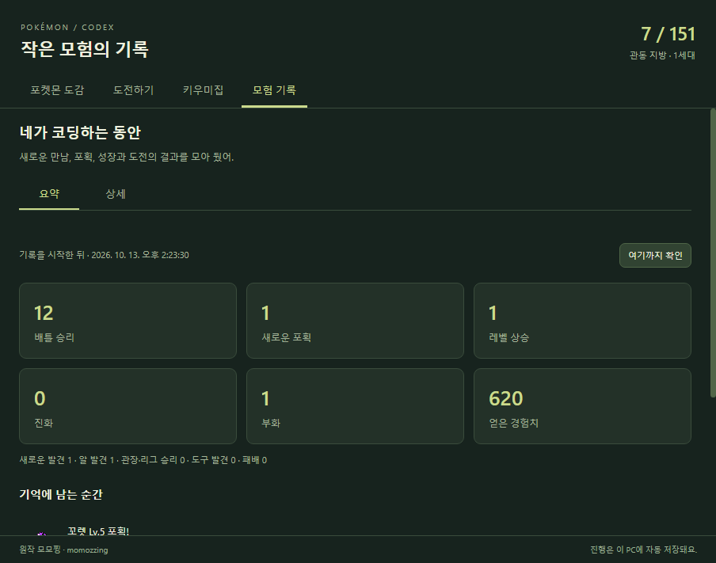
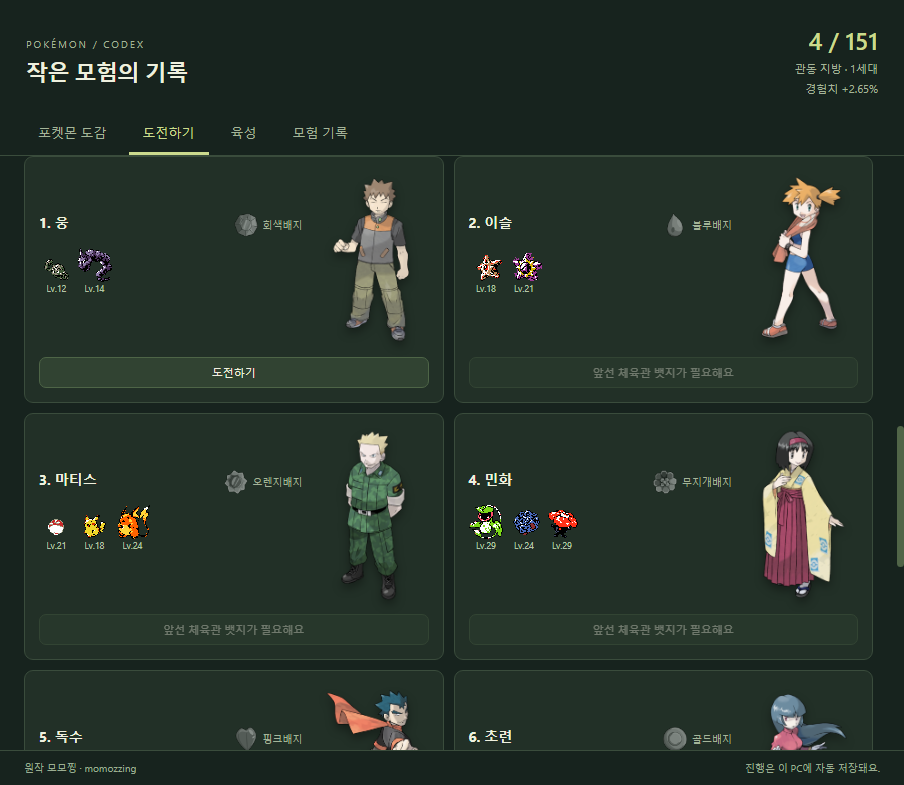
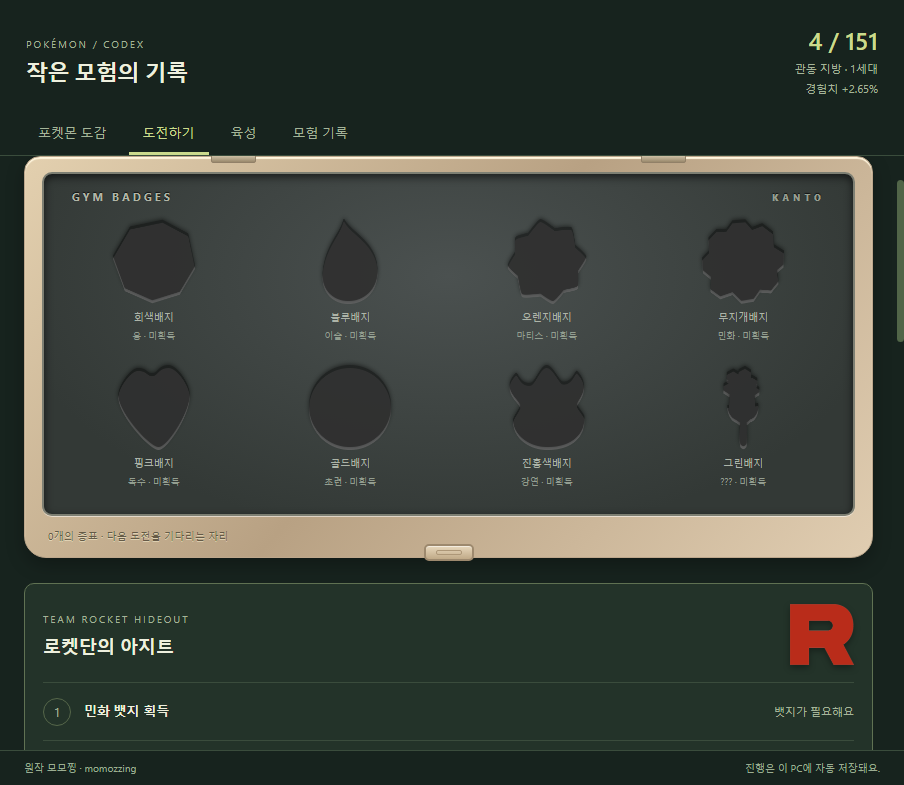

# Pokémon Codex Buddy

코딩하는 동안 포켓몬을 만나고, 잡고, 키우는 작은 데스크톱 게임. 작업이 끝난 뒤 도감과 모험 기록을 돌아볼 수 있습니다.

**원작 모모찡 · momozzing** — [Digimon_mod](https://github.com/momozzing/Digimon_mod)에서 출발한 비영리 팬 프로젝트입니다. 원작의 MIT 라이선스와 표기를 유지합니다.

**[Windows 실행 파일 받기 · 최신 릴리스](https://github.com/Bakzzi/Pokemon_codex/releases/latest)**

릴리스의 `Pokemon-Codex-0.3.26-portable.zip`을 받아 압축을 풀고 `PokemonCodex.exe`를 실행하세요. ZIP 안의 폴더와 파일을 함께 유지하면 됩니다. 소스 코드 ZIP은 실행 파일 배포본과 다릅니다.

도감과 모험 요약 미리보기

## 실행

- 포터블: 배포 폴더의 **PokemonCodex.exe**를 실행합니다. Node.js가 필요 없으며 폴더 전체를 함께 보관합니다.
- 소스: 처음에는 **Setup.cmd**, 이후 **Start Pokemon.vbs**를 실행합니다. Node.js 22.12 이상을 권장합니다.
- Codex를 재시작하거나 API 키·hooks를 설정할 필요가 없습니다. 소리와 팝업 없이 별도 위젯으로 동작합니다.
- 상단이나 배틀 배경을 드래그해 이동합니다. ⌖는 항상 위에, ▱는 작은 모드, −는 트레이로 숨기기, ×는 종료입니다.
- 네 개의 빠른 선택 칸 중 하나를 눌러 출전시킵니다. 동시에 싸우는 포켓몬은 한 마리입니다.
- 교체는 **볼 던지기 → 회수 → 볼을 가져오기 → 새 볼 던지기 → 포켓몬 등장** 순서로 약 4.6초 동안 보여줍니다. 수동 선택과 자동 교체에 같은 연출을 사용합니다.
- 작게 보기에서는 배틀 아래에 **5시간·주간 남은 사용 한도**를 표시합니다. 하단 메뉴, 기술 대사, Codex 연결 상태와 원작 표시는 숨기며, 펼치면 모두 다시 표시합니다.
- 작업을 기다릴 때는 작은 모드에서도 배틀 영역 가운데 상단에 **작업 대기중..**을 표시합니다. 문구 뒤의 작은 몬스터볼은 1초 멈춘 뒤 1초 동안 한 바퀴 도는 동작을 반복하며, 작업이나 배틀 연출이 진행되면 대기 표시가 사라집니다.
- 양쪽 포켓몬 아래에는 **이름·L레벨 → HP 바 → 현재/최대 HP** 순서의 체력창이 항상 보입니다. 작게 보기에도 유지하며, 실제 전투 체력에 따라 초록·노랑·빨강으로 바뀝니다.
- 상태 이상은 3세대처럼 **HP 바 왼쪽의 색상 배지**로 표시합니다. 독·맹독은 보라색, 마비는 노란색, 화상은 붉은색, 잠듦은 회색, 얼음은 하늘색이며, 맹독도 원작처럼 ‘독’으로 표시합니다. 이름과 레벨은 계속 보이고 작은 모드에서도 유지됩니다. 상태가 걸리거나 회복되면 기술이 적용되는 시점에 배지가 바뀌며, 정상일 때는 HP로 돌아옵니다.
- 연결 상태는 상단 **항상 위에 버튼 바로 왼쪽**에 표시합니다. 행동 말풍선은 실제 행동한 포켓몬 위에 뜨며, 포획 결과와 대기 안내는 가운데에 표시합니다. 이전 행동 말풍선은 잠시 뒤 사라져 상대의 새 행동과 구분됩니다.
- **도감 / 도전하기 / 모험 기록 / 육성**은 위젯 하단과 트레이에서 열 수 있습니다. 육성 탭에는 키우미집과 학습장치가 함께 있습니다.

## 도감과 동료

처음에는 1세대 **No.1~151**만 등장합니다. 2세대 크리스탈의 원본 애니메이션 도트를 사용하고, 전투 화면에서는 정수 배율 2배로 표시합니다. 양쪽 포켓몬이 가운데를 바라봅니다.

- 이상해씨·파이리·꼬부기·피카츄를 보유한 상태로 시작합니다.
- 미발견: 실루엣과 No.1 ???. 발견: 도트와 이름. 포획·진화·부화로 등록: 이름 왼쪽에 몬스터볼 표시.
- 도감에서 보유 개체를 선택하고 출전시키거나 네 칸 중 원하는 곳에 배치할 수 있습니다.
- 출전 교체는 현재 공격·포획·기절·교체 연출이 끝난 뒤, 진화·네 칸 배치·키우미집 맡기기는 현재 배틀과 마지막 연출이 끝난 뒤 자동 실행합니다. 조건을 기다리는 예약은 다른 모험을 막지 않습니다. 모든 모험 메뉴 위에 예약 목록·대기 이유·취소 버튼이 표시되고 재실행해도 유지됩니다. 동일 선택은 중복 예약되지 않으며, 출전 동료·같은 배치 칸·같은 개체의 진화 경로를 다시 선택하면 최신 선택으로 바뀝니다. 도전 중단·키우미집 동료 데려오기·성도 해금 선택도 진행 중인 연출을 기다립니다.
- 자동 교체는 **직접 배치한 네 칸 안에서만** 이루어집니다. 키우미집에 맡긴 동료는 제외하며, 박스의 다른 포켓몬을 데려오거나 네 칸의 구성을 바꾸지 않습니다.
- 출전 가능한 네 칸 동료의 최고·최저 레벨 차이가 **5 이상**이면, 야생 배틀이 끝난 뒤 **최저 레벨 동료**로 교체합니다. 다음 야생 상대는 새 동료의 레벨을 기준으로 등장합니다. 이미 최저 레벨이면 유지하고, 같은 레벨의 후보가 여럿이면 왼쪽 칸부터 고릅니다. 교체 자체로 행동 토큰을 소모하거나 경험치를 나누지 않습니다.
- 야생전·관장전 모두 출전 동료가 **기절하면 레벨 차이와 무관하게 살아 있는 최저 레벨 동료**가 이어받습니다. 상대의 체력과 포획 시도 횟수는 유지하며, 출전 가능한 동료가 모두 기절하면 배틀에서 패배합니다. 관장전 진행 중에는 레벨 차이만으로 교체하지 않습니다. 자동 교체 이유는 모험 기록에 남습니다.
- 같은 종이라도 부화한 개체는 서로 다른 동료입니다. 레벨·경험치·기술·성별을 개별 저장합니다.
- 진화하면 그 개체가 진화형으로 바뀝니다. 이전 종의 도감 등록은 계속 남습니다.
- 월이 바뀌어도 동료, 경험치, 도감과 뱃지는 초기화되지 않습니다.

## 모험과 포획

위젯 실행 중 새로 관측한 **Codex 출력 토큰 250개당 배틀 행동 1회**가 쌓입니다. 기술명 표시 → 공격·피격 → HP 감소 → 결과를 읽는 순서로, 기술 하나를 약 3.5초에 걸쳐 보여준 뒤 다음 행동을 시작합니다. 기절 장면과 교체, 포획 결과에도 별도 대기 시간을 두며, 기다리는 동안 행동 토큰을 추가로 쓰지 않습니다. 작업 중 모인 행동은 작업이 끝난 뒤에도 천천히 소진됩니다. 관측하지 않은 과거 사용량을 소급 계산하지 않습니다.

HP가 1 남았어도 피격 반응과 HP 감소를 마친 뒤 기절·교체합니다. 파티의 기절 표시도 화면 HP와 함께 바뀌며, 독·반동 같은 피해로 쓰러졌다면 피해 원인을 표시합니다.

출현 확률은 이 게임의 초기 밸런스입니다. 원작 특정 지역의 출현률을 전역 확률로 오해해서 쓰지 않습니다.

| 범주 | 기본 확률 | 챔피언 확률 |
|---|---:|---:|
| 흔함 | 64% | 59.945% |
| 보통 | 27.89% | 27.89% |
| 희귀 | 8% | 12% |
| 전설 전체 | 0.1% | 0.15% |
| 환상 전체 | 0.01% | 0.015% |

각 범주 안에서는 해금한 세대와 현재 출전 레벨에서 가능한 종을 추첨합니다. 챔피언 전에는 균등 추첨하고, 챔피언은 기본적으로 **미등록 종 가중치 2 / 등록 종 가중치 1**로 추첨합니다. 진화·부화로 등록한 종도 등록 완료로 취급하며, 개별 출현 확률이 정확히 2배가 된다는 뜻은 아닙니다. 챔피언의 희귀·전설·환상 범주 확률은 기본적으로 **1.5배**이며, 2세대 해금 여부와 관계없이 적용합니다. 출현 가능한 종이 없는 범주의 확률은 흔한 종으로 돌아갑니다. 일정 횟수 후 희귀종을 보장하지 않습니다. 희귀 범주는 포획률·종족값으로 분류하며 전설·환상은 별도 취급합니다.

챔피언은 **선택해 둔 4마리의 최저 레벨**에 따라 다음 보너스를 적용합니다. 네 칸에 배치된 개체의 레벨을 세며, 기절하거나 키우미집에 맡긴 동료도 그 칸에 있으면 포함합니다. 선택 칸을 바꾸면 새로 고른 네 마리의 레벨을 다시 계산합니다. 각 단계는 기본 출현 확률에 대한 배율입니다.

| 선택한 4마리 최저 레벨 | 희귀·전설·환상 배율 | 미등록 종 가중치 | 희귀 / 전설 / 환상 확률 |
|---|---:|---:|---:|
| Lv.70 이하 | 1.5배 | 2 | 12% / 0.15% / 0.015% |
| Lv.71~80 | 3배 | 3 | 24% / 0.3% / 0.03% |
| Lv.81~90 | 4배 | 4 | 32% / 0.4% / 0.04% |
| Lv.91~100 | 5배 | 5 | 40% / 0.5% / 0.05% |

- 새 야생 포켓몬은 출전 동료의 레벨 ±5에서 정하며, 진화에 필요한 최소 레벨을 지킵니다. 리자드는 동료 Lv.16부터, 리자몽은 Lv.36부터 출현하며 상대 자체의 레벨도 각각 16·36 이상입니다. 전설은 50, 환상은 30부터 가능합니다. 돌·교환 진화에는 임의의 추가 레벨을 만들지 않고 이전 단계의 레벨 조건을 이어받습니다.
- **한 번도 등록하지 않은 야생 종**만 포획합니다. 이미 등록한 종은 현재 보유하지 않아도 배틀만 합니다.
- 노란 체력(**20% 초과~50% 이하**)에서 일반 몬스터볼을 최대 **2회**, 빨간 체력(**0% 초과~20% 이하**)에서 최대 **3회** 던집니다. 두 구간의 횟수는 별도로 셉니다. 회복·동료 교체·재실행으로 사용한 횟수가 초기화되지 않으며, 노란 구간을 건너뛰면 빨간 구간의 3회만 시도합니다. 성공하면 즉시 멈춥니다.
- 포획 연출은 볼 투척·흡수·착지 후 간격을 두고 흔들립니다. 성공은 세 번 흔든 뒤 반짝이며 **포획 성공!**을 표시하고 다음 상대가 등장할 때까지 볼만 남습니다. 실패는 실제 판정에 따라 0~3회 흔들린 지점에서 볼이 열리고 포켓몬이 튀어나오며 **아쉽다!**를 표시합니다. 연출 중에는 다음 행동이나 교체가 끼어들지 않습니다. 포획 확률 자체는 동일합니다.
- 포획 성공 연출이 모두 끝난 뒤에 도감·보유 포켓몬 등록, 경험치·보상 지급과 배틀 종료·회복을 처리합니다. 볼을 던지거나 흔드는 동안 체력·레벨·포획 수로 결과를 미리 알 수 없으며, 연출 중 재실행해도 같은 결과를 한 번만 처리합니다.
- 미포획 상대도 기술·상태이상·반동 등의 정상 피해를 받습니다. HP가 0이 되면 포획 없이 기절하며, 못 잡은 종은 다음 만남에 다시 포획할 수 있습니다. 포획 구간을 건너뛰는 큰 피해도 그대로 적용합니다.
- [사용자가 지정한 포획률 문서](https://pokemon.fandom.com/ko/wiki/포획률)의 공식을 적용합니다. 종별 포획률과 HP·상태이상 보너스로 네 번 판정하며 일반 몬스터볼 배율은 1입니다.
- 승리·포획 당시 **출전 중인 한 개체는 기존 경험치를 그대로** 받습니다. 학습장치를 얻고 한 마리를 등록하면 그 동료에게만 추가로 **⌊출전 동료의 지급 예정 경험치 × 10%⌋**를 줍니다. 장치에 등록하지 않은 동료는 받지 않습니다. 최대 Lv.100이며 종별 성장 곡선을 사용합니다.
- **도감 경험치 부스터:** 1세대 등록 종 수 / 151만큼 추가 경험치를 받습니다. 최종 지급은 **기본 경험치 + ⌊기본 경험치 × 등록 수 / 151⌋**이며, 75종이면 약 +49.67%, 151종이면 +100%로 총 2배입니다. 스타팅·포획·진화·부화로 등록한 종을 포함하고 같은 종은 한 번만 셉니다. 현재 보유하지 않아도 등록 기록은 유효합니다. 챔피언 달성 전부터 야생 승리·포획·관장전에 적용하고, 2세대 해금 뒤에도 1세대 151종을 기준으로 최대 +100%를 유지합니다. 포획으로 새로 등록한 종은 성공 연출 종료 후 경험치를 지급할 때 반영합니다. 위젯과 도감에 현재 보너스를 표시합니다.
- 야생 승리나 포획 시 1.5% 확률로 현재 세대에 해당하는 진화 도구 중 하나를 발견합니다.
- 모험 기록은 **요약 / 상세**로 나뉩니다. 요약에는 지난 확인 이후의 승리·포획·성장·진화·부화·경험치와 주요 순간이 모입니다. **여기까지 확인**을 누르면 다음 구간부터 새로 집계하며, 창을 열거나 앱을 재실행하는 것만으로 초기화되지 않습니다.
- 상세에는 최근 모험 결과 300개와 배틀 행동 300개를 보관합니다. 특성 발동, 면역, 날씨, 상태이상, 기술 효과도 기록합니다. 오래된 상세가 정리돼도 요약 수치는 남습니다.

## 기술과 진화

기술 연출은 속성 기호 대신 **기술 ID**로 선택합니다. 포함된 354개 기술에 60가지 동작 패턴과 개별 변형을 연결했습니다. 불꽃세례는 여러 작은 불꽃, 화염방사는 이어지는 불길, 불대문자는 大자 불꽃으로 구분합니다. 물대포·거품·파도, 발톱·물기·돌진, 울음소리·단단해지기·회복도 다른 형태와 움직임으로 표현합니다. 픽셀 연출은 이 위젯용으로 제작한 것으로 원작의 전투 애니메이션을 그대로 복제한 것은 아닙니다.

공격 방향, 자기 대상 기술, 실제 연속 타격 횟수와 빗나감·면역·방어·충전을 전투 엔진 결과에 맞춥니다. 손가락흔들기 등으로 다른 기술이 호출되면 실제 실행한 기술을 표시합니다. 포획이 시작되는 타격도 먼저 끝난 뒤 몬스터볼을 던집니다. 연출은 무음이며 화면 전체를 번쩍이지 않습니다.

PokeAPI의 파이어레드·리프그린 레벨업 기술표, 3세대 당시 위력·타입·종족값과 타입 상성을 사용합니다. 해당 개체가 배운 기술은 **개수 제한 없이 전부 유지**하고 진화해도 계승합니다. 아직 배울 레벨에 도달하지 않은 기술을 미리 주지는 않습니다. PP, 상태, 상대 타입, 회복 필요성 등을 보고 자동으로 고르며 4개 제한과 기술 삭제는 없습니다. 기존 저장의 현재 종·레벨까지 배운 기술도 복구합니다. 관장·리그 상대는 원작의 지정 기술 편성을 사용합니다.

레벨, 진화의돌, 교환, 도구를 지닌 교환, 친밀도와 시간대 조건을 구분합니다. 도감에서 진화를 클릭하면 예약합니다. 필요한 레벨·도구·친밀도·시간대 조건을 충족하고 배틀과 마지막 연출이 끝나면 자동으로 진화합니다. 교환 진화는 **진화 전 모습의 해당 개체가 학습장치 경험치로 한 레벨 상승**하는 방식으로 대체합니다. 윤겔라·근육몬·데구리·고우스트는 최소 레벨 제한 없이 이 조건을 충족하면 진화를 자동 예약하며, 배틀과 마지막 연출 종료 후 진화합니다. 등록만 하거나 직접 출전해 오른 레벨, 이전 진화 단계에서 오른 레벨은 인정하지 않습니다. 도구를 지닌 교환 진화는 원래 도구도 필요합니다. 학습장치는 소모되지 않으며 진화한 개체가 그대로 학습을 이어갑니다. 친밀도 조건은 당시 기준 220, 낮/밤은 한국 시간 04~18시/그 외 시간입니다. 다음 세대 진화는 챔피언 달성 후 직접 2세대 해금을 선택할 때까지 잠깁니다.

전투 계산은 로컬에 포함한 **Pokémon Showdown / @pkmn/sim 0.10.11의 3세대 엔진**을 사용합니다. 타입별 물리·특수 구분, 자속 1.5배, 복합 상성·면역, 개체별 당시 특성, 급소·능력 단계·상태이상·날씨·장벽·우선도·PP를 처리합니다. 충전, 다음 턴 휴식, 반동, 연속 공격, 고정 대미지, 씨뿌리기, 대타출동, 카운터, 변신 등의 기술 효과도 엔진을 통해 처리합니다. 배틀 중 재실행하면 진행 중인 턴·효과·PP를 복원합니다.

현재 개체값 15, 노력치 0, 능력 보정 없는 성격은 공통입니다. 성격·개체값 수집과 지닌 도구 장착 UI는 아직 없습니다. 원작 대전 규칙에 자동 기술 선택, 모든 배운 기술 유지, 코딩 행동량과 자동 몬스터볼 투척을 결합한 작은 게임입니다. 야생 도주용 텔레포트도 현재 대전 규칙을 따릅니다. 기본 경험치는 PokeAPI 참조값을 사용합니다.

## 로켓단과 길을 막는 잠만보

**도전하기**에는 서로 분리된 두 영역이 있습니다. **로켓단의 아지트**에는 민화 뱃지 획득, 조무래기 승리, 로이·로사 승리, 비주기 승리의 네 단계만 표시합니다. **길을 막는 잠만보**에는 포켓몬피리가 있어야 도전할 수 있다는 조건만 표시하며, 피리가 없으면 버튼을 사용할 수 없습니다. 독수 카드에는 **길을 막는 잠만보 해결 시 해금**이라고 표시합니다. 획득할 보상과 아이템 입수 경로는 사전에 안내하지 않습니다.

- 민화 뱃지가 로켓단을 해금합니다. 조무래기는 레트라·주뱃 Lv.20, 로이·로사는 또가스·나옹·아보 Lv.25, 비주기는 롱스톤 Lv.25·뿔카노 Lv.24·캥카 Lv.29를 사용합니다. 세 단계는 **현재 동료들의 HP·PP를 유지하며 연속 진행**하고, 각 승리 결과와 다음 상대 등장 사이에 대기 시간을 둡니다. 완료한 단계는 다시 싸우지 않으며 패배·중단하면 다음 미완료 단계부터 재도전합니다. 8번째 체육관 비주기와 별도 기록이고 체육관 뱃지는 주지 않습니다. 로켓단의 포켓몬은 포획할 수 없습니다.
- **포켓몬피리**는 도구 목록에 보관되며 사용해도 소모되지 않습니다. 일반 야생 추첨에서는 **잠만보가 출현하지 않고**, 피리 사용 버튼으로만 **잠만보 Lv.30**을 깨워 만납니다. 획득 전에는 피리의 존재와 잠만보에게 필요하다는 점만 알려 줍니다.
- 피리로 만난 잠만보는 정상 야생 배틀·포획 규칙을 따릅니다. 한 번 포획하거나 기절시키면 길을 해결합니다. 못 잡았다면 피리를 다시 사용해 만날 수 있고, 한 번 포획 등록한 잠만보는 다시 포획하지 않습니다. 잠만보 배틀도 실제 코딩으로 쌓인 행동량을 사용하며 포획·기절 연출 종료 후 등록·경험치·진행을 한 번만 처리합니다. 실패·패배·무승부나 일반 야생에서 예전에 포획한 기록은 길 해결로 인정하지 않습니다.
- 야생 배틀 중 누른 로켓단 도전이나 피리 사용은 현재 배틀과 연출 종료 후 실행합니다. 기존 버전에서 이미 얻은 승리·아이템·포켓몬·뱃지는 보존하며 진행을 다시 잠그지 않습니다. 진행 중인 이벤트·예약과 마지막 연출도 이어서 처리합니다.

## 학습장치

**육성 탭 → 학습장치**에서 이용합니다. 획득 전에는 ‘미획득 · 획득 후 이용 가능’ 상태로 표시하며 입수 조건이나 보상 이벤트를 알려 주지 않습니다. 획득하면 동료 등록과 학습 기능이 열립니다. 동료 등록·진화는 현재 배틀과 연출이 끝난 뒤 처리하며 재실행해도 진행·예약·등록 동료를 유지합니다.
- **보유 동료 중 한 마리**를 학습장치에 따로 등록합니다. 네 칸 밖의 동료도 가능하며, 장치 등록이 네 칸 배치나 출전 동료를 바꾸지는 않습니다.
- 출전 동료의 경험치는 그대로이고, 등록 동료만 그 전투의 경험치 10%를 추가로 받습니다. 도감 경험치 부스터 적용 후 소수점을 내리며 야생·포획·관장·스토리 도전에 적용합니다. 등록 동료가 출전 중이면 추가 지급하지 않고, 키우미집에 맡겼거나 현재 배틀에서 기절했다면 학습하지 않습니다. Lv.100 상한과 개체별 기술 습득을 지킵니다. 출전 동료가 Lv.100이어도 등록 동료의 학습은 계속됩니다.
- 포획 성공 시 출전·학습 경험치 모두 **성공 연출 종료 후** 지급합니다. 학습장치 획득 이전 경험치를 소급 지급하지 않습니다. 모험 기록에는 스토리 승리·장치 획득·학습 경험치와 레벨 상승을 남깁니다.
- **교환 진화는 그 모습에서 학습장치로 한 레벨 오르면 자동 예약**합니다. 예: 윤겔라 Lv.16 → 학습장치 경험치로 Lv.17 → 배틀·결과 연출 종료 → 후딘 Lv.17. 개체별로 조건을 저장하므로 같은 종의 다른 동료나 캐이시 시절의 학습을 공유하지 않습니다. 도구·세대 해금이 필요하면 조건을 기다리며, 학습장치 동료를 바꿔도 이미 달성한 조건은 보존합니다. 자동 예약을 취소하면 다음 장치 레벨 상승 때 다시 예약하거나 도감에서 직접 진화를 예약할 수 있습니다. 기존 저장의 레벨 상승은 장치 경험치인지 알 수 없으므로 소급 인정하지 않습니다. Lv.100은 새로 레벨을 올릴 수 없습니다.

학습장치의 교환 진화 기능과 모험 진행 규칙은 이 프로젝트에서 정한 규칙입니다. 원작의 경험치 학습 도구를 참고했습니다.

## 키우미집과 예상 알

두 동료를 고르면 **예상 알 포켓몬의 이름·도트**, 가능한 조합인지와 불가능한 이유, 필요한 걸음을 맡기기 전에 보여 줍니다.

예: **샤미드 + 메타몽 → 이브이의 알 → Lv.5 이브이 → 다른 진화형**.

- 알 그룹·성별·메타몽 조합 규칙을 적용합니다. 전설·환상, 미발견 알 그룹, 메타몽끼리의 조합은 알을 얻지 못합니다.
- 메타몽이 없으면 알 그룹이 겹치는 암컷·수컷이 필요하며 암컷 계열의 기본형이 태어납니다. 니드런은 두 성별의 가능성을 모두 표시합니다.
- 맡긴 부모는 출전·진화를 쉬고 경험치를 받지 않습니다. 데려올 때 기존 레벨과 경험치를 그대로 유지합니다.
- 한 번 맡기면 알 하나를 얻습니다. **알 발견 20,000걸음**, 부화는 **종별 부화 주기 × 1,000걸음**입니다. 이브이는 부화까지 35,000걸음입니다.
- 1걸음은 새로 관측한 Codex 출력 토큰 1개입니다. 배틀 행동과 함께 진행하며 별도의 비용으로 차감하지 않습니다. 시간만 지나거나 앱을 재시작해서 진행도가 늘어나지 않습니다.
- 받은 알은 자동으로 품고, 부화한 개체는 동료 목록에 들어갑니다. 부모를 데려와도 받은 알은 유지됩니다. 알을 얻기 전에 부모를 데려오면 해당 알 발견 진행은 초기화됩니다.
- 한 번의 맡김으로 알이 끝없이 생기지 않습니다. 부화 후 다시 요청하면 다음 알을 기다립니다.
- **2세대 해금 전에는 알에서도 2세대가 나오지 않습니다.** 피카츄·메타몽처럼 피츄가 태어나는 조합은 해금 후 이용할 수 있습니다.
- 기존에 잡은 종을 야생에서 다시 잡는 규칙은 바뀌지 않습니다. 부화는 별도 획득 경로이며, 새로운 개체가 따로 성장합니다.
- 유전 기술·개체값 유전·향로 선택은 이번 버전에 포함하지 않습니다. 3세대 밖의 아기 포켓몬은 등장하지 않습니다.

## 체육관과 세대 해금

**관동 뱃지 홀더**에 여덟 뱃지가 두 줄로 놓입니다. 미획득 칸은 해당 뱃지 모양으로 파인 빈 홈이며, 관장에게 승리하면 실제 뱃지 이미지가 자리 잡고 짧게 빛납니다. 기존에 얻은 뱃지도 저장된 획득 상태에 맞춰 나타납니다. 뱃지 칸을 누르면 해당 체육관으로 이동합니다.

로켓단 아지트에는 원작 R 마크를 표시하며, 여덟 관장 카드에는 파이어레드·리프그린 원작 일러스트를 이름·뱃지·포켓몬 편성과 함께 표시합니다. 그림은 앱에 포함해 로컬에서 불러옵니다. 원본 출처와 파일 해시는 `desktop/assets/trainers/sources.json`, `desktop/assets/logos/sources.json`에 기록했습니다.

**도전하기**에서 웅 → 이슬 → 마티스 → 민화 → 독수 → 초련 → 강연 → 비주기 순으로 도전합니다. 민화 이후에는 길을 막는 잠만보를 포획하거나 기절시켜야 독수에게 도전할 수 있습니다. 상대 편성·레벨·기술은 파이어레드 첫 도전 자료를 기준으로 합니다.

뱃지 8개를 모으면 **칸나 → 시바 → 국화 → 목호 → 챔피언 그린**에게 연속 도전합니다. 리그 다섯 경기 동안 HP·PP는 이어집니다. 그린의 편성은 리자몽을 가진 분기로 고정합니다.

**한 번 뱃지를 얻은 관장에게는 재도전할 수 없습니다.** 화면 버튼과 게임 처리 양쪽에서 차단합니다. 패배하거나 중단한 관장은 다시 도전할 수 있고, 리그 재도전은 가능합니다. **관장·사천왕·챔피언의 포켓몬은 포획되지 않습니다.**

야생 배틀 중 **도전하기**를 누르면 도전을 한 건 예약합니다. 현재 야생 배틀의 포획·승리·패배와 마지막 연출까지 끝낸 뒤, 다음 야생 포켓몬을 만나기 전에 도전을 시작합니다. 야생 배틀은 기존처럼 Codex 작업량에 맞춰 진행하며, 시작된 관장·리그 도전은 코딩 여부와 무관하게 자동 배틀합니다. 예약은 저장되어 재실행 뒤에도 유지되며, 도전 화면의 **예약 취소**로 취소할 수 있습니다.

네 칸의 동료 중 키우미집에 맡긴 개체는 참가하지 않습니다. 도전 중 참가 동료를 교체할 수 있지만 팀 편성·진화는 잠깁니다. 승패·중단 후 야생 모험으로 돌아갑니다.

**챔피언에게 실제로 승리하면 출현 보너스와 2세대 해금 선택권을 얻습니다.** 도전하기 화면에서 **관동에 머물기** 또는 **2세대 해금하기**를 선택합니다. 머무르면 야생·도감·진화·알은 1세대 범위에 머물고, 원할 때 나중에 해금할 수 있습니다. 해금하면 2세대 100종이 추가되어 총 251종이 됩니다. 151종 수집 완료를 기다려도 되고, 그 전에 해금해도 됩니다. 해금 선택과 도감 기록은 재실행 뒤에도 유지됩니다. 기존 버전에서 이미 2세대 포켓몬을 만나거나 수집·육성한 기록은 보존합니다. 2세대 체육관·리그는 아직 만들지 않았습니다.

## Codex 연동과 저장

- %USERPROFILE%\.codex\sessions 또는 CODEX_HOME\sessions의 로컬 JSONL을 읽기 전용으로 관측합니다.
- 작업 시작·완료·중단·오류, 숫자 토큰·한도 필드만 추출합니다. 대화 본문·도구 인자·인증정보·계정 잔액은 저장하거나 전송하지 않습니다.
- 실행 중 외부 서버 통신, Codex 명령 실행, 세션 입력을 하지 않습니다. 데이터와 스프라이트는 로컬 파일입니다.
- 기록 안의 시각과 파일 크기 증가를 함께 확인해 최근 활동한 최대 64개 기록을 읽습니다. Windows에서 열린 파일의 수정 시각이 멈춰 있어도 감시 대상에 포함합니다. 목록은 약 5초마다, 추가분은 약 1.5초마다 확인합니다.
- 종료 기록 없이 10분 동안 새 이벤트가 없거나 기록 연결이 끊기면 **작업 상태 확인 중..**으로 표시합니다. 토큰 수신 공백을 작업 종료로 단정하지 않으며, 새 작업·토큰 이벤트가 들어오면 다시 작업 중으로 표시합니다.
- 5시간·주간 한도는 기록에 있는 실제 값을 표시합니다. 없거나 만료되면 미제공으로 표시합니다. 클라우드 전용 작업처럼 로컬에 기록되지 않는 활동은 반영하지 못합니다.
- 진행과 위치는 **%APPDATA%\PokemonCodexBuddy\progress.json**에 저장합니다. 자동 시작은 등록하지 않습니다.
- 0.1.0 진행 기록은 최초 실행 시 progress.pre-v2-*.json으로 백업한 뒤 옮깁니다. 기존 선택 파트너의 레벨, 관측 토큰 합계와 기준점을 보존하고 과거 토큰을 새 배틀에 소급 지급하지 않습니다.
- 0.3.0의 최초 규칙 전환 전에는 progress.pre-rules3-*.json으로 이전 기록을 보존합니다. 레벨·개체·도감·뱃지·키우미집 진행을 유지하며 기술 목록과 특성을 보완합니다.
- 손상된 기록은 덮어쓰지 않고 사본을 보존한 뒤 실행을 중단합니다. 새 기록을 이전 버전에서 열지 마세요. 이전 버전으로 돌아가려면 양쪽 위젯을 종료하고 해당 버전 백업을 복구해야 합니다.

## 개발과 검증

~~~powershell
npm.cmd ci
node --experimental-require-module node_modules/electron/install.js
npm.cmd test
npm.cmd run smoke
npm.cmd run package
~~~

검증은 실제 Codex 세션과 진행 기록을 쓰지 않는 임시 데이터로 수행합니다. 단위 검증은 포획 경계, 경험치 분리, 진화·부화, 저장 복원, 세대 해금과 개인정보 필터를 검사합니다. 화면 검증은 위젯·도감·교체·도전·키우미집 예상 알·부화를 검사하고 desktop/.smoke/에 캡처와 결과를 남깁니다.

## 출처

- **[모모찡 / Digimon_mod](https://github.com/momozzing/Digimon_mod)**, MIT, Copyright (c) 2026 momozzing. 원본 설명서는 docs/UPSTREAM_README.md에 보관합니다.
- [PokeAPI 데이터](https://github.com/PokeAPI/pokeapi/tree/81d20919845b6a445969b9265aab5cec6b04cece/data/v2/csv). 원본과 변환 자료·검증 결과는 reference/pokeapi/, 런타임 자료는 desktop/data/에 있습니다.
- [PokeAPI 크리스탈 스프라이트](https://github.com/PokeAPI/sprites/tree/master/sprites/pokemon/versions/generation-ii/crystal/animated). 251개 원본 URL·SHA-256은 desktop/assets/manifest.json에 있습니다.
- [Pokémon Showdown 전투 엔진 / @pkmn/sim](https://github.com/pkmn/ps/tree/main/sim), MIT. 실행에 필요한 고정 버전 패키지와 라이선스는 배포 폴더에 포함됩니다.
- 관동 뱃지 이미지는 [Bulbagarden Archives](https://archives.bulbagarden.net/wiki/File:Boulder_Badge.png)의 포켓몬 원본 일러스트를 사용합니다. 여덟 파일의 원본 URL과 SHA-256은 `desktop/assets/badges/sources.json`에 보관하며 앱은 로컬 이미지로만 표시합니다.
- [파이어레드 트레이너 편성](https://github.com/pret/pokefirered/blob/master/src/data/trainer_parties.h), [진화](https://github.com/pret/pokefirered/blob/master/src/data/pokemon/evolution.h), [키우미집 규칙](https://github.com/pret/pokefirered/blob/master/src/daycare.c).
- 포켓몬 명칭·캐릭터·게임 그림의 권리는 해당 권리자에게 있습니다. 코드의 MIT 라이선스가 포켓몬 자산에 적용되는 것은 아닙니다. Nintendo, Creatures, GAME FREAK, The Pokémon Company 또는 OpenAI의 공식·승인 프로젝트가 아닙니다.
